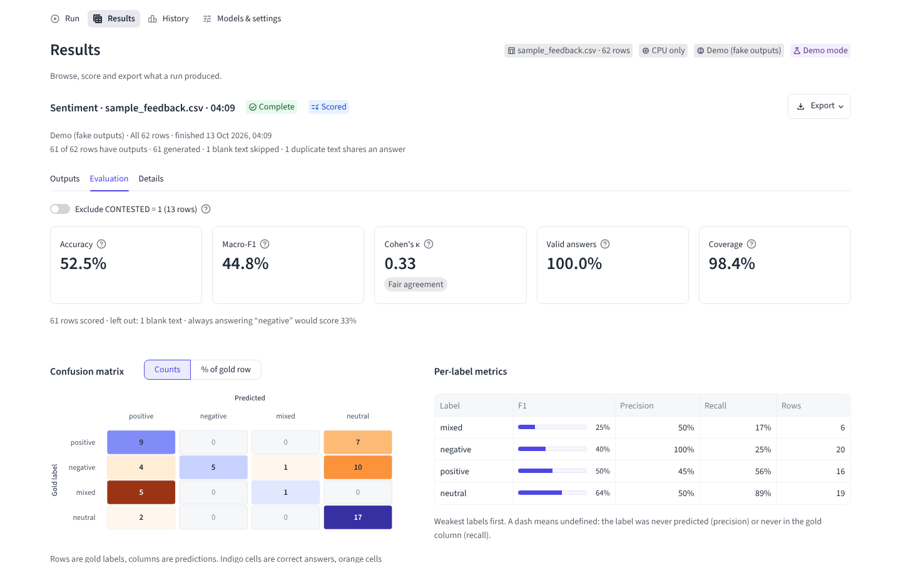

# Batch Text Review

Batch Text Review applies a prompt to every row of a table using a language model that runs on
your own machine, then scores the answers against a column of gold labels. Load a CSV or Excel
file, pick a task such as sentiment, intent or entity extraction (or write your own prompt),
choose a model, and get one output per row, ready to filter, export, and compare across models.
Your data never leaves your computer: each model is downloaded from Hugging Face once, then runs
locally on an NVIDIA GPU, Apple silicon, or the CPU.



- **Any table in.** CSV, TSV, TXT, Excel, Parquet, JSON and JSON Lines. Encodings (UTF-8, Excel's
  UTF-8 with BOM, Windows-1252, UTF-16) and delimiters are detected for you. You choose the text
  column.
- **16 task presets**, including classification, extraction and generation, plus custom prompts
  that you can save as your own presets.
- **14 curated local models** from 350M to 9B parameters, all of which fit an 8 GB GPU at 4-bit.
  You can also use any Hugging Face repo id or a model folder on disk.
- **Resumable runs.** Each output is saved as soon as its batch finishes. Re-running the same
  configuration is instant, an interrupted run picks up where it stopped, and only failed rows are
  retried.
- **Runs in the background** with live progress, rows per second, time remaining and a Cancel
  button. The longest texts go first by default, so the time estimate counts down and a model
  that runs out of memory fails at once. Results stay on screen when you click around.
- **Evaluation built in:** accuracy, macro-F1, Cohen's kappa, a clickable confusion matrix,
  per-class precision and recall, and accuracy by slice (for example by difficulty tier).
- **History.** Every scored run lands in a leaderboard, so you can compare models and prompts on
  the same data.
- **Clean exports.** CSV in UTF-8 with BOM, so Excel shows accents and £ signs correctly, or a
  formatted Excel workbook. Spreadsheet formula injection is neutralised.
- **Command line and Python API** for headless runs and scripting.

## Contents

- [Quick start](#quick-start)
- [Running the app](#running-the-app)
- [The workflow](#the-workflow)
- [Task presets](#task-presets)
- [Models](#models)
- [Saved outputs, caching and resume](#saved-outputs-caching-and-resume)
- [Evaluation](#evaluation)
- [Command line](#command-line)
- [Using it from Python](#using-it-from-python)
- [Configuration](#configuration)
- [Corporate networks](#corporate-networks)
- [Troubleshooting](#troubleshooting)
- [Project layout](#project-layout)
- [Development](#development)
- [Upgrading from version 1](#upgrading-from-version-1)
- [Licence](#licence)

## Quick start

You need Python 3.10 or newer (3.12 is recommended) and, for useful speed, an NVIDIA GPU with
8 GB of memory or more. Pick the section that matches your machine.

### Windows or Linux with an NVIDIA GPU (conda)

Install [Miniforge](https://conda-forge.org/download/) or Miniconda, then run this in a terminal
(on Windows, the Miniforge or Anaconda Prompt):

```bash
git clone https://github.com/tripptytrip/batchtextreview.git
cd batchtextreview
conda env create -f environment.yml
conda activate batchtextreview

# Check that PyTorch can see the GPU: expect "... True"
python -c "import torch; print(torch.__version__, torch.cuda.is_available())"

batchtextreview ui
```

`environment.yml` installs Python 3.12, the CUDA 12.8 build of PyTorch from download.pytorch.org,
and this project with its `llm` and `dev` extras. CUDA 12.8 suits GeForce RTX 20xx to 50xx cards.
For an older card (GTX 10xx), change the index URL in the file to `.../whl/cu126`.

### CPU only (any OS, no GPU)

```bash
python -m venv .venv
.venv\Scripts\activate            # Windows
source .venv/bin/activate         # Linux / macOS

pip install torch --index-url https://download.pytorch.org/whl/cpu
pip install -e ".[llm]"
batchtextreview ui
```

Generation on a CPU is slow. Use the smallest models (Granite-4.0-350M, Qwen2.5-1.5B) and a few
rows at a time. Auto loads the weights at fp32, because 4-bit needs an NVIDIA GPU.

### macOS (Apple silicon)

```bash
python3 -m venv .venv
source .venv/bin/activate
pip install -e ".[llm]"
batchtextreview ui
```

The standard PyTorch wheels use the Apple GPU (MPS) at 16-bit precision. 4-bit quantisation is not
available on macOS, so stick to models of about 4B parameters or less on machines with 16 GB of
memory.

### Just looking (no PyTorch at all)

```bash
pip install -e .
batchtextreview ui --demo
```

Demo mode adds a **Demo (fake outputs)** model that answers instantly with plausible fake
outputs. Use it to try the interface, the evaluation views and the exports on the bundled sample
data. `--demo` is the same as setting `BTR_DEMO=1`, for this launch only.

## Running the app

From the repository root:

```bash
streamlit run app.py
# or, from anywhere once the package is installed
batchtextreview ui
python -m batchtextreview ui
```

The app opens at <http://localhost:8501>. Options after `--` go to Streamlit, for example
`batchtextreview ui -- --server.port 8502`. `batchtextreview ui --results-dir D:\btr\results` uses
another results folder for this launch, and `--demo` adds the demo model.

Only this computer can open the app. To let colleagues on your network use it, start it with
`batchtextreview ui -- --server.address 0.0.0.0` (or `streamlit run app.py --server.address 0.0.0.0`)
and allow Python through the firewall. Anyone who can reach the port can then run models, see
your results and history, and open data files from this computer's disk on the **Run** page, so
only do this on a network you trust.

Results are stored in `results/batchtextreview.db`, inside the folder you launch from. To keep
one results database wherever you launch from, set `BTR_RESULTS_DIR` (see
[Configuration](#configuration)).

## The workflow

The app has four pages: **Run**, **Results**, **History** and **Models & settings**.

1. **Load data** (Run page, step 1). Upload a file, open one from a folder, or click
   **Sample data** to load `examples/sample_feedback.csv`. In the folder box you can paste either
   a folder or a full file path. Quotes from Windows' "Copy as path" are removed, and the last
   folder is remembered. For Excel files you can pick a sheet.
2. **Pick the text and gold columns.** The text column is guessed (a column called TEXT, BODY,
   COMMENT and so on, otherwise the longest text), and you can change it. Optionally pick an ID
   column and a **gold-label** column holding the correct answers. With a label set chosen, the
   page checks the gold column live, for example "58 / 61 gold values match the allowed
   answers", and warns when the gold column clearly belongs to another task.
3. **Choose a task** (step 2). Pick a preset by category (Classify, Extract, Generate, Custom, or
   your Saved presets), then edit the prompt as you like. `{text}` is replaced by each row's text,
   and `{var}` by the value in the task's variable box (for example the categories for
   *Categorise*). **Allowed answers** is the closed label set. It produces the LABEL column and
   makes the run scorable. Clear it for open-ended output, or tick **Score by exact match** to
   compare free-text output with the gold column. Use **Preview prompt** to see the exact prompt
   for the first selected row, and **Save as preset** to keep the prompt for later.
4. **Pick a model and plan the run** (Run plan card). Choose a model, or **Custom model…** for any
   Hugging Face repo id or local folder. Then choose the rows (**All**, **First rows** or
   **Random sample**, the sample drawn with a fixed seed so it is repeatable) and the number of
   rows. **Advanced** holds the max output tokens, batch size, **Processing order**, **Weights**
   (Auto, 4-bit, fp16 or fp32: the precision the model is loaded in) and the max input characters
   per row. *Longest first* (the default order) starts with the longest texts, so the time
   estimate starts high and counts down, and a model that runs out of memory fails in the first
   batch rather than near the end. *Shortest first* shows the first results sooner. The app
   remembers your choice. The plan shows how many rows are selected, how many already have saved
   outputs, and how many still need the model. When some are saved, **Discard saved outputs**
   deletes them for this configuration.
5. **Run.** The button reads **Generate N rows**, or **Show saved results** when everything is
   already saved, and shows its keyboard shortcut. The run continues in the background while you
   use the other pages, and you can cancel it at any time. Everything generated before you cancel
   is kept. The progress bar measures the work done rather than rows, so a long text counts for
   more than a short one, and the time left is smoothed so one slow batch doesn't make it jump.
6. **Results → Outputs.** The input table plus `OUTPUT`, `LABEL`, `CORRECT` and `STATUS`
   columns, `ERROR` when something failed, and `NOTE` when a text was cut to the max input
   characters or an output reached the max output tokens ("output may be cut off"). You can filter
   by outcome (correct, wrong, invalid, errors, blank) or by predicted label, and search the text.
   Click a row to see the full text and output, the label against the gold value, and the exact
   prompt that was sent. The **Export** menu downloads all rows as CSV or Excel, or the filtered
   view as CSV. JSON tasks also get one column per key (`OUTPUT.people`, `OUTPUT.dates`, …) and
   `OUTPUT.valid_json`.
7. **Results → Evaluation.** KPI tiles (with the change since the previous run on the same data),
   a confusion matrix (click a cell to list those rows), per-class metrics, and accuracy by slice.
   A 0/1 flag column such as `CONTESTED` can be excluded from the headline numbers with a toggle.
8. **History.** A leaderboard of every scored run, filterable by dataset, task and gold column,
   with charts of accuracy against macro-F1 and of scores over time. Each row records the model,
   weights, prompt preset and data fingerprint, so comparisons are like for like.

**Models & settings** shows the device (GPU name, memory, which weights Auto picks), the loaded
model with an **Unload** button, the model catalogue with download status, your saved outputs
(each can be deleted), and where the database and the log file live.

## Task presets

| Preset | Category | Output | Allowed answers | Max tokens |
|---|---|---|---|---:|
| Sentiment | Classify | label | positive, negative, mixed, neutral | 8 |
| Emotion | Classify | label | joy, anger, sadness, fear, surprise, disgust, neutral | 8 |
| Intent | Classify | label | complaint, query, request, praise, other | 8 |
| Urgency (1-5) | Classify | label | 1, 2, 3, 4, 5 | 8 |
| Yes/No question | Classify | label | yes, no; `{var}` is your question | 8 |
| Categorise | Classify | label | your categories, from `{var}` (comma-separated) | 16 |
| Language | Classify | text | open | 8 |
| Entity extraction | Extract | JSON | `people`, `organisations`, `locations`, `dates` | 256 |
| Keywords | Extract | text | open (3-5 comma-separated phrases) | 32 |
| Extract a field | Extract | text | open; `{var}` describes the field (NONE if absent) | 32 |
| Aspect sentiment | Extract | JSON | one sentiment per aspect listed in `{var}` | 96 |
| PII detection | Extract | JSON | `pii`: list of personal details found | 256 |
| Topics | Generate | text | open (1-3 topic labels) | 24 |
| One-line summary | Generate | text | open (20 words or fewer) | 48 |
| PII redaction | Generate | text | open (personal data replaced by `[REDACTED]`) | 1024 |
| Custom prompt | Custom | text | open, or your own label set | 256 |

"Max tokens" is the default output length. It is deliberately short for labels: generation time
grows with it, so a sentiment run with 256 tokens is many times slower than one with 8. Every
prompt is shown in full and can be edited before running. The original wording is one click away
(**Reset to preset**).

## Models

| Model | Hugging Face repo | Size | Notes |
|---|---|---:|---|
| Granite-4.0-350M | `ibm-granite/granite-4.0-350m` | 350M | tiny |
| Granite-4.0-1B | `ibm-granite/granite-4.0-1b` | 1B | |
| Qwen2.5-1.5B-Instruct | `Qwen/Qwen2.5-1.5B-Instruct` | 1.5B | fastest |
| Granite-4.0-Micro | `ibm-granite/granite-4.0-micro` | 3B | |
| Qwen2.5-3B-Instruct | `Qwen/Qwen2.5-3B-Instruct` | 3B | faster |
| Llama-3.2-3B-Instruct | `meta-llama/Llama-3.2-3B-Instruct` | 3.2B | gated |
| Phi-3.5-mini-Instruct | `microsoft/Phi-3.5-mini-instruct` | 3.8B | |
| Phi-4-mini-Instruct | `microsoft/Phi-4-mini-instruct` | 3.8B | |
| Qwen3-4B-Instruct-2507 | `Qwen/Qwen3-4B-Instruct-2507` | 4B | |
| Qwen3.5-4B | `Qwen/Qwen3.5-4B` | 4B | experimental |
| Qwen2.5-7B-Instruct | `Qwen/Qwen2.5-7B-Instruct` | 7.6B | best quality |
| Llama-3.1-8B-Instruct | `meta-llama/Llama-3.1-8B-Instruct` | 8B | gated |
| Qwen3-8B | `Qwen/Qwen3-8B` | 8.2B | |
| Qwen3.5-9B | `Qwen/Qwen3.5-9B` | 9B | experimental |

- **First use downloads the model** into the Hugging Face cache (from under 1 GB to about
  18 GB). After that it loads from disk. Only one model is held in memory at a time, and switching
  models frees the previous one first.
- **Weights** (precision; `--precision` on the command line). *Auto* chooses 4-bit (NF4, via
  bitsandbytes) on an NVIDIA GPU, fp16 on a GPU without bitsandbytes or on Apple silicon, and fp32
  on the CPU. At 16-bit, a model needs roughly 2 GB per billion parameters, so on an 8 GB card use
  4-bit for anything above about 3B.
- **Gated** models (Meta's Llama) need two things. First, accept the licence on the model's page
  on huggingface.co while logged in. Second, give the app a Hugging Face access token: create a
  *read* token under Settings → Access Tokens, then either set it as the `HF_TOKEN` environment
  variable ([Configuration](#configuration)) or save it once with `hf auth login`, and restart the
  app.
- **Experimental** models use new architectures and need an up-to-date `transformers`
  (`pip install -U transformers`).
- **Thinking models** (Qwen3) are asked to answer directly. Any `<think>…</think>` block that still
  appears is removed from the output.
- **Your own model:** choose **Custom model…** and enter a repo id (`org/name`) or the path of a
  local folder containing `config.json`, the tokenizer files and the weights.

## Saved outputs, caching and resume

Every output is written to the results database (`results/batchtextreview.db`, SQLite) as soon as
its batch finishes. Outputs are filed under a **run id**, a short hash of everything that changes
what the model generates:

- the model: its Hugging Face repo id, or for a local model folder its absolute path plus a
  fingerprint of its model files (names, sizes and modification times);
- the weights precision actually used (Auto is resolved first, for example to `4bit`);
- the final prompt template, with `{var}` already filled in, character for character;
- the max output tokens;
- the max input characters (longer texts are truncated before they are sent).

Within a run id, each row is looked up by a hash of its (truncated) text. As a result:

- **Re-running an identical configuration is instant** and doesn't load the model.
- **Interrupted or cancelled runs resume.** Run again, and only the rows without a saved output
  are generated.
- **Duplicate texts are generated once** and shared.
- **Failed rows are never saved**, so a re-run (or the **Retry** button on the Results page)
  regenerates exactly those.
- **Blank texts are never sent to the model.** They get status `blank` and are excluded from
  scoring.

These things do **not** create a new run id, so saved outputs are reused:

- batch size and processing order (longest or shortest texts first), which change speed, not
  outputs;
- which rows you select (All / First rows / Random sample), and their order;
- the file name or format, other columns, and the name of the text column (only the text itself
  counts);
- the gold column and the allowed answers (labels are resolved after generation, so you can
  re-score without regenerating);
- a model's display name;
- restarting the app.

Changing any character of the prompt, the variable, the model, the weights, max output tokens or
max input characters starts a fresh run id; the old outputs stay available for that old
configuration. So does re-saving or replacing the files in a local model folder (a fine-tune saved
again, for example), or copying the folder elsewhere. Because Auto resolves per machine, outputs
made at 4-bit on a GPU are not reused by a CPU (fp32) run.

To discard saved outputs, click **Discard saved outputs** under the run plan, or select them under
**Models & settings → Saved outputs** and delete. On the command line, use `--no-cache` to neither
read nor write the store.

## Evaluation

Pick a gold-label column and a task with allowed answers (or turn on exact match), and the run is
scored automatically.

**Matching answers.** Model outputs and gold values are both normalised before they are compared:
case, surrounding punctuation, quotes and markdown are ignored, and so is a lead-in such as
"Answer:" or "Sentiment:". "4/5" and "4 out of 5" count as 4, and "3.0" matches 3. A sentence such
as "The sentiment is positive." resolves when exactly one allowed label appears in it as a whole
word. A negated label ("not positive") does not count, and "very positive" beats "positive" when
both are allowed. Anything else is never guessed. It is marked `[invalid]`.

| Metric | Meaning |
|---|---|
| Accuracy | Correct ÷ scored rows. |
| Macro-F1 | The F1 score (balance of precision and recall) averaged over labels with equal weight, so rare labels count as much as common ones. Labels mode only. |
| Cohen's κ (kappa) | Agreement with the gold labels after removing what chance would give: 1 is perfect, 0 is chance level, below 0 is worse than chance. Better than accuracy when one label dominates. |
| Invalid outputs | Scored rows whose output did not resolve to exactly one allowed label. They count as wrong, appear as **Invalid** in the confusion matrix, and read `[invalid]` in the `LABEL` column. |
| Excluded rows | Rows with no model output to judge: blank text, generation errors, or rows not run because the run was cancelled. They are left out entirely instead of being counted as wrong. |
| Unscorable gold | Rows whose gold value is empty or (in labels mode) outside the label set. They are skipped and reported. |
| Slices | Rows scored, correct answers and accuracy per value of any column with 2-20 distinct values, such as `TIER`. Slices with fewer than 5 scored rows are flagged as too small to read much into. |

Every evaluation is logged to **History** with its run id, the dataset's fingerprint, the gold
column and the label set. Scoring the same thing again updates that line instead of adding a
duplicate.

The bundled `examples/sample_feedback.csv` is a 62-row, gold-labelled set of synthetic
public-library and council-services feedback, with labels for both Sentiment and Intent.
Difficulty rises over three tiers: explicit statements, then understatement, negation and mixed
feelings, then sarcasm, rhetorical questions and stance-versus-topic traps. It also has a
`CONTESTED` flag for rows where a reasonable annotator could disagree, and a `RATIONALE` for every
label.

## Command line

The same engine is available without the browser. Progress is shown on one updating line (the
share of the work done, rows, rate, time remaining). Ctrl+C stops cleanly after the current batch
and writes the partial results. The examples below break long commands with `\`. In PowerShell,
end the lines with a backtick (`` ` ``) instead, or put the whole command on one line.

```bash
# Score a sentiment run on the sample data and log it to History
batchtextreview run examples/sample_feedback.csv --preset Sentiment \
    --model Qwen2.5-1.5B-Instruct --gold GOLD_SENTIMENT

# Your own categories, an Excel input, Excel output
batchtextreview run tickets.xlsx --sheet Tickets --text-column Body --preset Categorise \
    --var "billing, delivery, account, other" --model Qwen/Qwen2.5-3B-Instruct \
    --output tickets_categorised.xlsx

# A prompt from a file, a local model folder, the first 100 rows only
batchtextreview run notes.csv --template-file prompt.txt \
    --model "C:\models\Qwen2.5-7B-Instruct" --precision 4bit --batch-size 4 --limit 100

# Check a command line without a GPU
batchtextreview run examples/sample_feedback.csv --preset Intent --model demo://fake

batchtextreview models                         # built-in models
batchtextreview presets                        # presets, their labels and default lengths
batchtextreview presets -v                     # ... with each preset's prompt
batchtextreview history                        # the newest 20 History entries (--limit 0: all)
batchtextreview history --output history.xlsx  # all of History, every column (.csv or .xlsx)
batchtextreview device                         # GPU, the weights Auto picks, library versions
batchtextreview import-legacy "C:\old\results" # import version-1 results (docs/MIGRATING.md)
```

`run` options:

| Option | Default | Meaning |
|---|---|---|
| `INPUT` | | File to read (any supported format). |
| `--sheet NAME` | first visible sheet | Excel sheet to read (matched ignoring case). |
| `--text-column COL` | guessed | Column holding the text. |
| `--preset KEY` | | Preset key or title. Optional when `--template` / `--template-file` is given. |
| `--template TEXT`, `--template-file PATH` | | Use this prompt instead of the preset's. It must contain `{text}`. |
| `--var VALUE` | | Value for `{var}`. |
| `--labels "a,b,c"` | preset's | Override the allowed answers. `""` means open output, scored by exact match. |
| `--model NAME` | required | Model label, repo id, version-1 label, or local folder. |
| `--precision` | `auto` | Weights: `auto`, `4bit`, `fp16`, `bf16` or `fp32`. |
| `--max-new-tokens N` | preset's | Max output tokens. |
| `--max-input-chars N` | 8000 | Truncate longer texts. |
| `--batch-size N` | 8 | Rows generated together. |
| `--order` | `longest` | Which texts go first: `longest` (the time estimate counts down, and a model that runs out of memory fails in the first batch) or `shortest` (the first results appear sooner). Saved outputs are reused either way. |
| `--limit N` | 0 (all) | Only the first N rows. |
| `--gold COL` | | Score against this column and log to History. |
| `--output PATH` | `<input>_<preset>_<model>_results.csv` | Results file, by default next to the input (lower-case names, so runs of different models don't replace each other). `.xlsx` writes Excel. Given a folder, the default name is used inside it. An existing file is replaced, with a note. JSON presets get one column per key. |
| `--no-cache` | | Don't read or write saved outputs, and don't log to History. |
| `--results-dir DIR` | `BTR_RESULTS_DIR` | Where the results database lives. |

Exit codes: `0` on success; `1` for invalid input, a model that fails to load, a run in which no
row could be generated, or results that had to be saved somewhere other than `--output` (the file
was open in Excel, for example); `2` for a command-line mistake (a missing or invalid option); and
`130` after Ctrl+C. Errors are one message, without a traceback.

`batchtextreview -v <command>` also prints debug details to the terminal. `-v` goes before the
command (`batchtextreview presets -v` lists the presets in detail instead). Every command that
uses the results folder logs to `results/logs/batchtextreview.log` (see
[Troubleshooting](#troubleshooting)).

`import-legacy [FOLDER]` imports the version-1 files in `FOLDER` (default: the results folder)
into the current results database. Like `run`, the `presets`, `history` and `import-legacy`
commands use `./results` or `BTR_RESULTS_DIR`, and take `--results-dir DIR` to use another
folder.

## Using it from Python

Version 1's `llm_batch.run_batch(...)` has a direct replacement. In a script or a notebook:

```python
from pathlib import Path

from batchtextreview import data, engine, evaluation, models, presets, prompting, results
from batchtextreview.backends.manager import ModelManager
from batchtextreview.config import Settings
from batchtextreview.store import Store

table = data.read_table("examples/sample_feedback.csv").frame
preset = presets.get_preset("Sentiment")
var = None  # the {var} value, for presets such as Categorise
config = engine.RunConfig.build(
    models.resolve_model("Qwen2.5-1.5B-Instruct"),  # a model name, repo id or local folder
    prompting.apply_variable(preset.template, var),  # checks the prompt and fills in {var}
    preset.max_new_tokens,
    precision="auto",
)
store = Store(Settings.from_env().db_path)  # the app's saved outputs (None: don't use them)
result = engine.execute_run(config, table["TEXT"].tolist(), store=store, manager=ModelManager())

print(result.outputs[:3], result.statuses[:3])  # one output and one status per row
print(result.stats)  # generated, cached, blank and error counts, timings

labels = preset.resolve_labels(var)
frame = results.build_results_frame(table, result, labels)  # adds OUTPUT, LABEL, STATUS...
report = evaluation.evaluate(
    frame["LABEL"], frame["GOLD_SENTIMENT"], labels, include=results.scorable_mask(result)
)
print(f"accuracy {report.accuracy:.1%}, macro-F1 {report.macro_f1:.3f}")
Path("sentiment_results.csv").write_bytes(results.to_csv_bytes(frame))  # UTF-8 with BOM
```

`execute_run` never raises for a model that fails to load or a batch that fails: check
`result.aborted_reason` and the rows whose status is `error`. Pass `store=None` to neither read
nor save outputs, and `order="shortest"` to start with the shortest texts (the default,
`"longest"`, starts with the longest). Keep one `ModelManager` for the whole session, so the model
loads only once.

## Configuration

Everything is optional and set through environment variables. `batchtextreview ui --demo` and
`batchtextreview ui --results-dir DIR` set `BTR_DEMO` and `BTR_RESULTS_DIR` for that launch only,
and `batchtextreview -v ui` sets `BTR_VERBOSE`.

| Variable | Default | Meaning |
|---|---|---|
| `BTR_RESULTS_DIR` | `./results` | Folder for `batchtextreview.db` and the `logs` folder, relative to the launch folder. |
| `BTR_DATA_DIR` | launch folder | Folder offered first when opening a file from disk. |
| `BTR_DEMO` | off | `1` adds the **Demo (fake outputs)** model. |
| `BTR_VERBOSE` | off | `1` adds debug details to the log file and prints them in the terminal too (the same as `batchtextreview -v`). |
| `BTR_NO_TRUSTSTORE` | off | `1` turns off OS certificate-store validation (see below). |
| `HF_TOKEN` | | Hugging Face access token, needed for gated models. |
| `HF_HUB_OFFLINE` | off | `1` never contacts huggingface.co and loads models only from the local cache. |
| `HF_HOME` | `~/.cache/huggingface` | Where downloaded models are kept. Move it to a disk with space. |

How to set a variable:

```powershell
# PowerShell, current window only
$env:BTR_RESULTS_DIR = "D:\batchtextreview\results"
# Windows, permanently for new windows
setx BTR_RESULTS_DIR "D:\batchtextreview\results"
# conda, permanently for this environment only (re-activate afterwards)
conda env config vars set BTR_RESULTS_DIR=D:\batchtextreview\results
```

```bash
export BTR_RESULTS_DIR=~/batchtextreview/results     # Linux / macOS
```

Three variables are set for you at startup, unless you have set them yourself.
`KMP_DUPLICATE_LIB_OK=TRUE` avoids the Intel OpenMP clash between Anaconda and PyTorch on Windows.
`HF_HUB_DISABLE_SYMLINKS_WARNING=1` hides a harmless warning on Windows without developer mode,
where the Hugging Face cache copies files instead of linking them. `TOKENIZERS_PARALLELISM=false`
stops the tokenizers library from competing with the app's worker thread.

## Corporate networks

- **TLS inspection (Zscaler and similar).** At startup the app uses
  [truststore](https://pypi.org/project/truststore/), so Python validates HTTPS against the
  operating system's certificate store. That store already trusts your company's inspection
  certificate, which means model downloads work without copying certificate bundles around. Set
  `BTR_NO_TRUSTSTORE=1` to turn this off. Recent pip (24.2 and later) already uses the system
  store. For conda, run `conda config --set ssl_verify truststore`.
- **Proxy.** If you need an explicit proxy, set `HTTPS_PROXY` (and `HTTP_PROXY`) before
  launching.
- **Gated models** need a token, from `HF_TOKEN` or `hf auth login` (see [Models](#models)). The
  **Models & settings** page shows whether one is set and where it comes from, but never its
  value.
- **huggingface.co blocked?** Download the model on a machine that can reach it, then copy the
  folder across:

  ```powershell
  hf download Qwen/Qwen2.5-3B-Instruct --local-dir D:\models\Qwen2.5-3B-Instruct
  ```

  In the app, choose **Custom model…** and paste the folder path. On the command line, use
  `--model D:\models\Qwen2.5-3B-Instruct`. Saved outputs for a local model are filed under its
  folder path and its files, so keep the folder where it is and unchanged: moving or copying it,
  or saving new weights into it, starts afresh.
- **Flaky or slow network.** Once a model is in the cache, `HF_HUB_OFFLINE=1` skips the online
  update check and loads straight from disk.

## Troubleshooting

The app and the command line log what they do, including every model-load failure in full, to
`logs/batchtextreview.log` in the results folder (by default `results/logs/batchtextreview.log`;
**Models & settings** shows the exact path). The file rotates at 1 MB and keeps three old copies.
For debug details, set `BTR_VERBOSE=1` or start with `batchtextreview -v`. Attach the log when you
report a problem.

| Symptom | Fix |
|---|---|
| `torch.cuda.is_available()` is `False`, and on Windows the version has no `+cu128` | pip installed a CPU-only PyTorch. Run `pip uninstall -y torch`, then `pip install torch --index-url https://download.pytorch.org/whl/cu128`. Also check that `nvidia-smi` works, since an outdated driver also causes this. |
| "4-bit quantisation needs the bitsandbytes package" or a bitsandbytes CUDA error on Windows | `pip install -U bitsandbytes` (it ships Windows wheels). Until that works, set **Weights** to fp16 (`--precision fp16`): models up to about 3B fit an 8 GB card. |
| "Not enough memory (RAM) to load …" | The weights don't fit in the computer's main memory, which is what a CPU run uses: about 4 bytes per parameter at fp32, so 6 GB for a 1.5B model. Choose a smaller model and close other programs. |
| CUDA out of memory | The app already halves a batch that runs out of memory and retries. With the default processing order (longest first) this shows in the first batch, and a run whose longest texts don't fit can stop before generating anything: choose **Shortest first** (`--order shortest`) to generate the shorter texts first. If a single row still fails, lower the batch size, lower the max input characters, choose 4-bit, or use a smaller model. Close other programs that use the GPU (check with `nvidia-smi`). Long outputs (PII redaction, 1024 tokens) need the most memory. |
| 401 / 403 / "gated repo" when loading Llama | Accept the licence on the model's huggingface.co page with the same account as the token, set `HF_TOKEN`, and restart the app. Environment variables are read at launch. |
| `OMP: Error #15: Initializing libiomp5md.dll, but found libiomp5md.dll already initialized` | The app sets `KMP_DUPLICATE_LIB_OK=TRUE` itself. You will only see this error in your own scripts that import torch before `batchtextreview`. Set the variable there, or use the conda environment from `environment.yml`, which avoids the clash. |
| "does not recognize this architecture" | The model is newer than your `transformers`. Run `pip install -U transformers`. |
| The first run sits on "Loading…" for minutes | The model is being downloaded, and later runs load from disk. Set `HF_HOME` to move the cache to a larger disk. |
| Every label is `[invalid]` | The model is answering in sentences. Raise the max output tokens slightly, make the prompt stricter ("Reply with one word only"), or try a larger model. Open a row on the Results page to see the full output. |
| Port 8501 already in use | `batchtextreview ui -- --server.port 8502` |
| "… was written by a newer version of Batch Text Review" | The results database was upgraded by a newer copy of the app (it records its schema version, currently 3). Update this copy (`git pull`, then `pip install -e .`), or point `BTR_RESULTS_DIR` at another folder. An older database is upgraded automatically. |

## Project layout

```
app.py                            Streamlit entry point
environment.yml                   conda environment (CUDA)
examples/sample_feedback.csv      gold-labelled sample data
docs/MIGRATING.md                 upgrading from version 1
docs/screenshot.png               the screenshot above
src/batchtextreview/
  _env.py, config.py              environment defaults; settings from environment variables
  logs.py                         the log file and -v / BTR_VERBOSE
  models.py, presets.py           model catalogue and task presets
  prompting.py, labels.py         templates; output cleaning and label resolution
  data.py                         reading tables, guessing columns
  engine.py                       run planning, batching, checkpointing
  store.py                        SQLite results store, version-1 import
  evaluation.py, results.py       metrics; result tables and exports
  jobs.py                         background run worker
  backends/                       model loading (transformers), demo backend, model manager
  cli.py                          command line
  ui/                             Streamlit pages, components, charts, theme
tests/                            pytest suite
```

## Development

```bash
pip install -e ".[dev]"     # add ",llm" (and a PyTorch install) for the model tests

pytest -q                   # whole suite; "llm" tests skip without torch/transformers
pytest -m "not ui"          # skip the Streamlit AppTest tests
pytest -m llm               # transformers backend against a tiny random model built locally
ruff check .                # lint
ruff format .               # format
mypy src                    # type check
```

The `llm` tests build a two-layer model with random weights on disk, so they need PyTorch but no
network and no GPU. CI (`.github/workflows/ci.yml`) runs lint plus the test suite on Ubuntu and
Windows with Python 3.10 and 3.13, without PyTorch.

## Upgrading from version 1

Version 2 is a rebuild. Your old saved outputs and evaluation history can be imported with one
click (History page) or with `batchtextreview import-legacy`. Some behaviour has changed: errors
now have their own column, CSV exports are Excel-friendly, and the app only accepts connections
from this computer. Scripts that called `llm_batch.run_batch` can use the
[Python API](#using-it-from-python). See [docs/MIGRATING.md](docs/MIGRATING.md) and the
[changelog](CHANGELOG.md).

## Licence

No licence has been chosen yet. Until one is added, all rights are reserved by the author.
